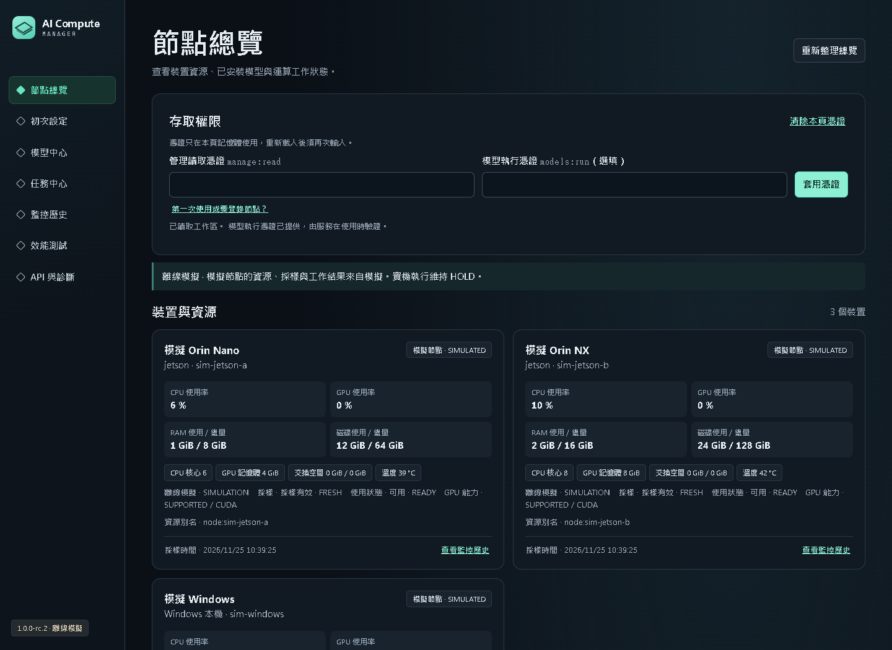

# AI Compute Manager v1.0.0-preview.1

ACM provides a local dashboard, resource observations from Windows and signed devices, scoped management APIs, and a durable simulated work queue. The UI labels data provenance, freshness, and execution eligibility. The preview listens on IPv4 loopback.

## Quick start on Windows

Verify the archive SHA-256 and extract to a fresh protected source directory. Use a verified Node.js 24.22.3 runtime and choose a new data directory beneath a trustworthy local parent.

~~~powershell
$install = Join-Path $env:LOCALAPPDATA 'ACM-Preview'
node tools/rc.mjs setup $install --monitor-local
node tools/rc.mjs doctor $install
node tools/rc.mjs token issue $install viewer manage:read
.\start.cmd (Join-Path $install 'config.json')
~~~

Open the local URL printed by the console. The default is http://127.0.0.1:8787/. Enter the read credential in the dashboard. Use Ctrl+C for normal shutdown.

To try model jobs, create a separate installation with --simulation, issue a separate models:run credential, and use the benchmark and task panels. [Sample simulated job](docs/screenshots/simulation-job.png)

## Agent and API

The Linux ARM64 Agent supports unprivileged installation and signs read-only samples over standard input and output. Enroll the public key and a separate telemetry publisher identity in the controller, then relay a fresh sample. The existing V0.6/V0.7 observer formats can also be projected and signed after an authorized observer verifies the running source. Production process and named-pipe attachment remain a separate qualification.

- [Install, update, and restore](docs/INSTALL.md) · [Agent install and retire](docs/AGENT-INSTALL.md)
- [Telemetry contract](docs/TELEMETRY.md) · [HTTP and client examples](docs/API.md)
- [Architecture](docs/ARCHITECTURE.md) · [Compatibility and hardware plan](docs/HARDWARE-RUNBOOK.md)
- [Security](SECURITY.md) · [Supply chain and license decision](docs/LICENSE-REVIEW.md)
- [Traditional Chinese README](README.md)

Real inference, remote ingress, production deployment, publication, and global CLEANUP remain independently gated.

## Qualification scope

Native Windows standard-account qualification is complete, with 10 Owner and 5 independent Peer cases. Offline ARM64 qualification completed one real Ollama JSON request and one SSE request, including signed terminal evidence, durable locks, reclamation, and ordered commits. These results do not authorize standing hardware dispatch.

Current Windows, Orin Nano A and Orin NX observations have passed a bounded live integration through the verified read-only source and V1 signed telemetry interface. Local Chrome verified resources, model inventories and valid empty resident lists. The observer and V1 controller ran in one trusted operator process; separate API-account and named-pipe deployment remain unqualified. See the [current qualification matrix](docs/QUALIFICATION-MATRIX.md).

On 2026-11-26, an Orin NX passed one controlled Legacy bounded CPU request in 4.969 seconds, with terminal, reclamation, and host-restoration receipts. The exact peak remains `null`, and the original R1 exact-peak qualification stays separate. Read-only and simulated trials remain available within their existing scope. Cross-host and GPU execution have separate hardware admission gates. See the [compatibility matrix](docs/COMPATIBILITY.md), [GPU admission plan](docs/GPU-ADMISSION.md), and [deployment and rollback plan](docs/PRODUCTION-CUTOVER.md).
