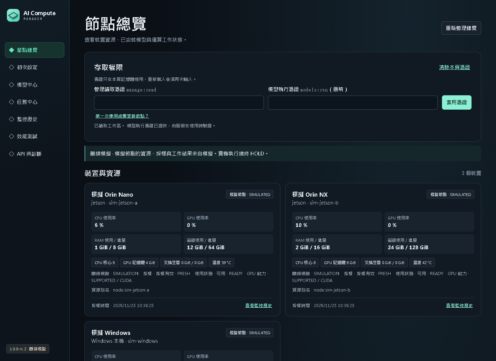

# AI Compute Manager v1.0.0-preview.1

可在本機查看資源與簽章設備遙測，管理分權 API 及派送合成工作。Dashboard 會顯示資料來源、時間與工作資格。公開 API 與預設設定都只使用 IPv4 loopback。

## Windows 快速開始

確認安裝包 SHA-256，解開到新的受保護程式目錄。使用已核對的 Node.js v24.22.3，選擇沒有其他帳號可以替換的新資料位置。

~~~powershell
$install = Join-Path $env:LOCALAPPDATA 'ACM-Preview'
node tools/rc.mjs setup $install --monitor-local
node tools/rc.mjs doctor $install
node tools/rc.mjs token issue $install viewer manage:read
.\start.cmd (Join-Path $install 'config.json')
~~~

控制視窗會顯示本機位址，預設 http://127.0.0.1:8787/。將剛取得的讀取憑證填入 Dashboard。用 Ctrl+C 正常停止。

另建安裝位置可使用 --simulation，並簽發獨立的 models:run 憑證。效能測試頁面可建立模擬工作，再到任務中心查看結果、用量與清理回報。[模擬工作畫面](docs/screenshots/simulation-job.png)

## 產品資料與資格

- [安裝、升級及回復](docs/INSTALL.md)
- [Windows 和簽章設備遙測](docs/TELEMETRY.md) · [Jetson Agent 安裝](docs/AGENT-INSTALL.md)
- [API、OpenAPI 和客戶端](docs/API.md) · [架構](docs/ARCHITECTURE.md)
- [相容性](docs/COMPATIBILITY.md) · [下一次設備驗收](docs/HARDWARE-RUNBOOK.md)
- [安全政策](SECURITY.md) · [供應鏈、SBOM 及授權](docs/LICENSE-REVIEW.md)
- [English README](README.en.md)

真實推論、CLEANUP、遠端連線、正式部署與公開發布各自保留准入。

## 本候選的驗收範圍

Windows 標準帳號驗收已完成，Owner 10/10、獨立 Peer 5/5。離線 ARM64 已完成真實 Ollama 非串流和 SSE，以及可信終態、持久鎖與回收提交。這些結果屬於對應的隔離環境，不提供持續實機派送資格。

本輪已讓 Windows、Orin Nano A 與 Orin NX 的真實資料經受核對的唯讀來源進入 V1 簽章介面，並在 Chrome 核對資源、模型與有效空駐留清單。這是同一可信操作程序的限定整合驗收，獨立 API 帳號與命名管道部署仍待驗。詳見 [最新資格矩陣](docs/QUALIFICATION-MATRIX.md)。

2026-11-26，Orin NX 的 Legacy bounded CPU 單次實機驗收通過，單請求 4.969 秒，終態、資源回收與主機復原均有回條。精確峰值仍為 `null`，原 R1 精確峰值資格另行保留。候選的唯讀與模擬功能可依原範圍試用，跨主機與 GPU 維持各自的實機准入。最新逐項界線見 [相容性矩陣](docs/COMPATIBILITY.md)、[GPU 專項計畫](docs/GPU-ADMISSION.md) 及 [部署回滾準備](docs/PRODUCTION-CUTOVER.md)。
